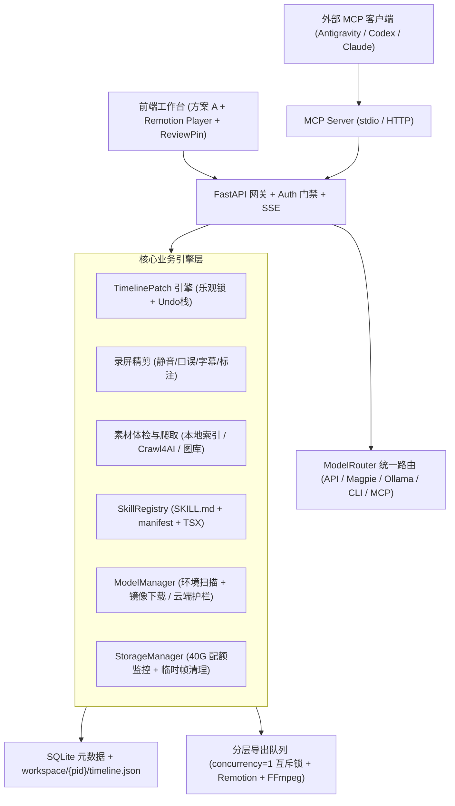

# ReelForge v3.0 系统架构、迁移策略与双部署约束

> 上级索引：[agent/agent.md](file:///Users/ryan/Documents/tools/ReelForge/agent/agent.md)

---

## 1. v2.0 → v3.0 核心架构跃迁

v2.0 是单轨「静态图片拼接机」（Playwright 截 PNG → `edge-tts` → FFmpeg），v3.0 升级为 **「多轨时间轴 + Remotion 动态渲染 + FFmpeg 分层合成 + 本地媒体理解」** 工作台：

| 维度 | ReelForge v2.0（已锁定基线） | ReelForge v3.0（目标架构） |
|---|---|---|
| **内容形态** | 纯静态图文科普（9 套卡） | 四合一：系统录屏精剪 / 真人口播 / AI 资讯混剪 / 会动的 HTML 科普 |
| **数据模型** | 单轨线性列表 `scenes[]` | 5 轨 `TimelineDocument` + 词级 `TranscriptDocument` + `ReviewPin` |
| **预览与导出** | 改字段等后端截图，无实时动画 | 前端 `@remotion/player` 浏览器内实时预览 + 后端 Remotion/FFmpeg 分层导出 |
| **协同入口** | 仅表单驱动 | 人工时间轴/文稿直接改 + 画布框选 `ReviewPin` + 内置助手/外部 MCP 双入口 |
| **部署模式** | 仅面向本机桌面 | **双运行画像自适应**：`local_mac`（16G 本地开发/剪辑）+ `cloud_2c2g`（2核2G40G 国内云服务器） |

### 五条架构铁律
1. **单一真相源与非破坏性编辑**：`workspace/{project_id}/timeline.json` 为唯一工程真相；所有修改走原子 `TimelinePatch` + `timeline_revisions` 快照；原始视频只读引用，绝不破坏原片。
2. **预览算力放浏览器端**：`@remotion/player` 运行在用户本地浏览器，服务端零渲染压力；大录屏统一走 720p Proxy 代理流式预览。
3. **审片批注闭环（ReviewPin）**：用户可在帧上画框提需求，连同截帧和坐标一起交给内置 AI 或外部 MCP 精准改片。
4. **硬件自适应路由**：本机 16G 可跑轻量本地模型；2C2G 服务器强制开启内存防爆保护，推理与 ASR 全走云端国内 API。
5. **Skill 与开源组件优先**：动效收敛在 `motion/` 与 `skills/`，UI 组装成熟开源库（见 [design.md](file:///Users/ryan/Documents/tools/ReelForge/agent/design.md)）。

---

## 2. 系统分层架构

---

## 3. 仓库演进目录与 `main` 平滑迁移

### 3.1 目标目录结构
* `agent/`：本套 6 份模块化文档（唯一架构与进度真相）。
* `skills/`：`motion-editorial`、`screen-tutorial`、`ai-news-montage` 等可插拔编导目录。
* `motion/`：Remotion 共享动效组件包（前端 `@remotion/player` 与后端导出 CLI 共用同源 TSX）。
* `backend/app/`：在现有 `core/`, `db/`, `api/`, `media/`, `schemas/` 基础上增量扩展 `services/`（`timeline_engine.py`, `asr_service.py`, `screen_editor.py`, `asset_indexer.py`, `web_sourcing.py`, `skill_registry.py`, `storage_manager.py`）。
* `frontend/src/`：基于 `shadcn/ui` + `react-resizable-panels` 重构方案 A 首页与 4 区工作台。

### 3.2 `main` 分支原地平滑迁移
1. **SQLite 增量建表**：保留既有 5 张表，启动幂等新增 `timelines`, `timeline_revisions`, `transcripts`, `media_assets`, `review_pins`, `model_downloads`。
2. **v2.0 工程兼容**：打开旧项目时若无 `timeline.json`，自动将 `scenes` 转换为 `motion_card` 主轨片段 + `subtitle` + `audio`。
3. **脏数据清理**：M1 上线新首页时清理 `workspace/` 中的 `验收草稿 768/1440`，仅保留 3 个干净示例工程。

---

## 4. 双部署画像硬约束：`local_mac` vs `cloud_2c2g`（重点）

系统必须原生适配两种差距悬殊的运行环境，**特别针对 2 vCPU / 2 GB RAM / 40 GB 磁盘的国内轻量云服务器**：

| 工程维度 | `local_mac`（本机：Apple Silicon / 16 GB） | `cloud_2c2g`（国内云服：2 核 / 2 GB RAM / 40 GB SSD） |
|---|---|---|
| **运行识别方式** | `POST /api/system/probe` 自动检测 RAM ≥ 8 GB，或手动切换 | 自动检测 RAM < 4 GB（或 `.env` 指定 `DEPLOY_PROFILE=cloud_2c2g`） |
| **并发控制（防 OOM 核心）** | 导出并发 `RENDER_CONCURRENCY=1~2`，Playwright `Semaphore(2)` | **全局重任务互斥信号量 `RENDER_CONCURRENCY=1`、`BROWSER_CONCURRENCY=1`**；转码、导出、无头爬虫严格排队，严禁并发启动两个重进程 |
| **FFmpeg 与 Remotion 资源限额** | 允许默认线程与较高并发 | FFmpeg 强制 `-threads 2 -preset veryfast` 控内存与 CPU；Remotion 导出强制 `--concurrency=1` 且任务结束立即销毁浏览器实例；Linux 部署文档推荐配 **2~4 GB Swap** 作安全气囊 |
| **本地模型防爆护栏** | 允许下载并运行轻量本地 ASR（580MB）与 Ollama VLM | **硬拦截 > 300 MB 本地权重下载/加载**，强制 ASR/LLM/VLM 走零内存占用的国内云端 API（见 `models_and_sourcing.md`） |
| **文件上传内存保护** | 10 MB 限额 | **全量改为流式分块落盘（chunk 1 MB）**：废除 `await file.read()` 整包读入内存（当前 v2.0 `assets.py` 会将文件全读入 RAM），支持最大 500 MB 录屏上传而进程内存仅占 **< 4 MB** |
| **40 GB 磁盘生命周期** | 保留完整中间帧与缓存方便调试 | 扣除 OS/Python/Node/Chromium/FFmpeg 后可用约 **20~24 GB**；① 导出完成并校验 `final.mp4` 后**自动清理中间 PNG/alpha 序列帧**；② 提供「一键清理 Proxy 代理与旧版本修订文件」及过期 TTL 自动淘汰；③ 顶栏/设置展示磁盘配额条（**80% 橙色告警、90% 禁止新上传**） |
| **公网暴露与目录安全** | 绑定 `127.0.0.1` 免登录 | 若绑定 `0.0.0.0` 对外提供访问，启用 `.env` 单用户 **`ACCESS_TOKEN` 鉴权中间件**；本地素材扫描严格限制在白名单 `LIBRARY_ROOT` 目录沙箱内，禁止任意路径穿越 |
| **预览期服务端负载** | 0（浏览器端渲染） | **0**（`@remotion/player` 在用户电脑浏览器内渲染，2C2G 服务器仅以 HTTP `206 Range` 静态分段吐出 720p Proxy 视频流） |
