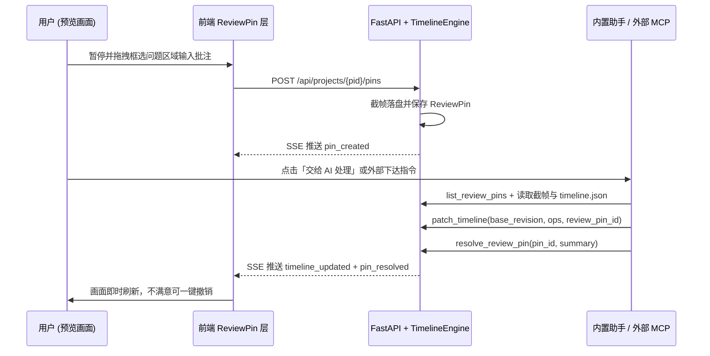

# ReelForge v3.0 核心数据契约、Skill 规范与接口表

> 上级索引：[agent/agent.md](file:///Users/ryan/Documents/tools/ReelForge/agent/agent.md)

---

## 1. `TimelineDocument`（5 条语义轨道工程文件）

存储于 `workspace/{project_id}/timeline.json`，所有时间单位为毫秒（`ms`），统一 `30fps` 基准：

```json
{
  "schema_version": 3,
  "project_id": "proj_abc123",
  "revision": 14,
  "fps": 30,
  "format": "video_16_9",
  "resolution": { "width": 1920, "height": 1080 },
  "skill_id": "screen-tutorial",
  "theme": "clean_light",
  "tracks": {
    "main_video": [
      {
        "id": "clip_01",
        "kind": "motion_card",
        "skill_id": "motion-editorial",
        "component_id": "cover",
        "duration_ms": 3000,
        "transition_out": { "type": "fade", "duration_ms": 300 },
        "props": { "tag": "系统演示", "title": "3分钟学会自动对账", "subtitle": "录屏精剪示例" }
      },
      {
        "id": "clip_02",
        "kind": "video_clip",
        "asset_id": "asset_rec_01",
        "source_in_ms": 4200,
        "source_out_ms": 18600,
        "speed": 1.0,
        "volume": 1.0,
        "crop": { "mode": "cover", "focus_x": 0.5, "focus_y": 0.5 },
        "frame_style": { "rounded": true, "padding": 32, "wallpaper": "soft_slate" },
        "transcript_segment_ids": ["seg_01", "seg_02"]
      },
      {
        "id": "clip_03",
        "kind": "placeholder",
        "duration_ms": 4000,
        "prompt_hint": "缺素材：需要「对账成功导出」截图或 4 秒录屏",
        "fallback_card": { "component_id": "checklist", "props": { "heading": "核对 3 项", "items": [] } }
      }
    ],
    "overlay": [
      {
        "id": "ov_01",
        "kind": "broll_image",
        "asset_id": "asset_web_shot_09",
        "start_ms": 6500,
        "duration_ms": 2800,
        "rect": { "x": 0.62, "y": 0.14, "w": 0.32, "h": 0.36 },
        "border_radius": 16
      }
    ],
    "annotation": [
      {
        "id": "ann_01",
        "kind": "zoom_focus",
        "start_ms": 5000,
        "duration_ms": 3200,
        "target_rect": { "x": 0.18, "y": 0.25, "w": 0.34, "h": 0.22 },
        "zoom_scale": 1.65,
        "spotlight": true,
        "callout_text": "点击这里发起校验"
      }
    ],
    "subtitle": [
      {
        "id": "sub_01",
        "transcript_segment_id": "seg_01",
        "start_ms": 3100,
        "end_ms": 6800,
        "text": "打开对账中心后，先核对筛选条件",
        "highlight_words": ["对账中心"],
        "style_preset": "pill_dark"
      }
    ],
    "audio": [
      {
        "id": "aud_bgm_01",
        "kind": "bgm",
        "asset_id": "bgm_default_01",
        "start_ms": 0,
        "duration_ms": 21400,
        "volume": 0.35,
        "ducking_db": -12,
        "fade_in_ms": 600,
        "fade_out_ms": 1200
      }
    ]
  }
}
```

主轨允许 4 类片段：`video_clip`（本地实拍/录屏切片）、`image_clip`（图片+Ken Burns 动效）、`motion_card`（动态 TSX 卡片）、`placeholder`（缺料占位槽，保证流水线永不卡死）。

---

## 2. 原子化 `TimelinePatch` 与乐观锁

前端操作、文稿删词、内置 AI 与外部 MCP 必须通过统一原子 Patch 接口更新工程，并携带 `base_revision` 防止并发覆盖：

```typescript
interface TimelinePatchRequest {
  base_revision: number;          // 不匹配当前版本返回 409 Conflict + 最新文档
  actor: "user" | "internal_ai" | "mcp_agent";
  summary: string;                // 写入修订历史的中文摘要
  review_pin_id?: string;         // 关联触发修复的 ReviewPin
  ops: TimelineOp[];
}

type TimelineOp =
  | { op: "insert_clip"; index: number; clip: MainClip }
  | { op: "trim_clip"; clip_id: string; source_in_ms?: number; source_out_ms?: number; duration_ms?: number }
  | { op: "split_clip"; clip_id: string; split_at_ms: number }
  | { op: "delete_clip"; clip_id: string }
  | { op: "reorder_clips"; clip_ids: string[] }
  | { op: "replace_clip_asset"; clip_id: string; asset_id: string; source_in_ms?: number; source_out_ms?: number }
  | { op: "update_motion_props"; clip_id: string; props_patch: Record<string, unknown> }
  | { op: "upsert_overlay"; item: OverlayItem }
  | { op: "delete_overlay"; item_id: string }
  | { op: "upsert_annotation"; item: AnnotationItem }
  | { op: "delete_annotation"; item_id: string }
  | { op: "update_subtitle"; segment_id: string; text?: string; start_ms?: number; end_ms?: number; highlight_words?: string[] }
  | { op: "split_subtitle"; segment_id: string; split_char_index: number }
  | { op: "merge_subtitles"; segment_ids: [string, string] }
  | { op: "batch_replace_terms"; replacements: Array<{ find: string; replace: string }> }
  | { op: "upsert_audio"; item: AudioItem }
  | { op: "delete_audio"; item_id: string };
```

每次 Patch 成功：原子写盘 `.tmp`→`replace`、追加记录到 `timeline_revisions` 支持无限步 Undo/Redo、SSE 广播 `timeline_updated`。

---

## 3. `TranscriptDocument`（非破坏性文本剪辑）

```json
{
  "asset_id": "asset_rec_01",
  "engine": "mlx-whisper-large-v3-turbo-q4",
  "hotwords": ["ReelForge", "FastAPI", "Playwright"],
  "segments": [
    {
      "id": "seg_01",
      "text": "我们先打开，那个，对账中心",
      "start_ms": 4200,
      "end_ms": 7400,
      "words": [
        { "id": "w1", "text": "我们", "start_ms": 4200, "end_ms": 4480, "tag": "normal", "deleted": false },
        { "id": "w4", "text": "[停顿 0.8s]", "start_ms": 5020, "end_ms": 5820, "tag": "pause", "deleted": true },
        { "id": "w5", "text": "那个", "start_ms": 5820, "end_ms": 6180, "tag": "filler", "deleted": true },
        { "id": "w6", "text": "对账中心", "start_ms": 6300, "end_ms": 7400, "tag": "normal", "deleted": false }
      ]
    }
  ]
}
```

映射规则：连续 `deleted == false` 的词块自动合并为保留区间（默认 `padding_ms=80ms` 呼吸缓冲，间隔 `< 220ms` 不硬切），同步更新主轨 `video_clip` 切片与 `subtitle` 时间；点击划线灰字即可随时恢复。

---

## 4. `ReviewPin`（画面审片批注闭环）

```json
{
  "id": "pin_004",
  "project_id": "proj_abc123",
  "revision_id": 14,
  "timestamp_ms": 5600,
  "frame_path": "workspace/proj_abc123/pins/pin_004.png",
  "bbox": { "x": 0.16, "y": 0.22, "w": 0.36, "h": 0.24 },
  "target_track": "annotation",
  "target_item_id": "ann_01",
  "comment": "放大框偏左，请右移到提交按钮位置并精简提示文案",
  "status": "open",
  "resolution_summary": null
}
```



---

## 5. `MediaAsset`（素材库与体检报告）

```json
{
  "id": "asset_rec_01",
  "scope": "library",
  "source_type": "local_file",
  "original_path": "/data/media/对账演示.mov",
  "sha256": "9f86d081...",
  "media_type": "video",
  "width": 2560,
  "height": 1440,
  "duration_ms": 94200,
  "proxy_path": "workspace/.library/proxies/asset_rec_01_720p.mp4",
  "keyframes": [{ "timestamp_ms": 14500, "thumb_path": "...", "vlm_caption": "财务对账界面校验按钮" }],
  "quality_flags": ["high_res_screen"],
  "source_url": null
}
```

---

## 6. 编导 Skill 插件目录规范（`skills/`）

```text
skills/<skill-id>/
├── SKILL.md           # YAML frontmatter (name, description, supported_formats) + 编导节奏与标注规则
├── manifest.json      # 变量定义与组件 Props JSON Schema（供前端自动生成表单与校验）
└── components/*.tsx   # 可选专属 React/Remotion 动效组件（由 motion/ 统一注册加载）
```

首发 3 套内置 Skill：
1. `motion-editorial`：承接并动画化 v2.0 9 套排版模板（会动的 HTML 科普视频）。
2. `screen-tutorial`：系统录屏操作教程（开场卡 → 录屏+自动放大标注 → 总结清单卡）。
3. `ai-news-montage`：AI 资讯/宣传片混剪（3 秒钩子快切 + 网页截图画中画 + 数据动效卡 + 节奏高亮字幕）。

---

## 7. REST API 与 MCP Tool 全量契约映射

| 接口域 | REST API（前端调用） | MCP Tool（外部 Agent 调用） |
|---|---|---|
| **环境、模型与存储** | `POST /api/system/probe`, `POST /api/models/download`, `PATCH /api/system/routing`, `GET /api/system/storage`, `POST /api/system/storage/purge` | `get_system_capabilities` |
| **Skill 体系** | `GET /api/skills`, `GET /api/skills/{skill_id}` | `list_skills`, `read_skill` |
| **工程与时间轴** | `GET /api/projects/{pid}/timeline`, `PATCH /api/projects/{pid}/timeline`, `POST .../undo`, `POST .../redo` | `get_timeline`, `patch_timeline`, `undo_timeline` |
| **文稿与字幕** | `POST /api/projects/{pid}/transcribe`, `PATCH /api/projects/{pid}/transcript` | `get_transcript`, `edit_transcript_cuts`, `update_subtitles` |
| **素材体检与爬取** | `POST /api/library/scan`, `POST /api/projects/{pid}/sourcing`, `POST .../web-capture`, `GET /api/media/{aid}/stream` | `search_local_assets`, `crawl_web_media`, `capture_webpage_shot`, `attach_asset` |
| **审片批注** | `GET/POST /api/projects/{pid}/pins`, `POST /api/projects/{pid}/pins/{pin_id}/ai-fix` | `list_review_pins`, `resolve_review_pin` |
| **导出与交付** | `POST /api/projects/{pid}/render`, `GET /api/projects/{pid}/publish-kit` | `render_project`, `get_project_status` |
