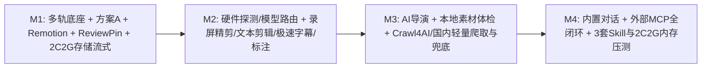

# ReelForge v3.0 顺序开发路线图与风险预案

> 上级索引：[agent/agent.md](file:///Users/ryan/Documents/tools/ReelForge/agent/agent.md)

---

## 1. 实时里程碑状态看板

> **执行顺序**：已确认按 **`M1 → M2 → M3 → M4`** 严格顺序推进；每个里程碑均包含自动化单测与真实流式/视觉验收门禁，完工后同步回写此表。

| 里程碑 | 状态 | 核心范围摘要 | 最近关联 Commit |
|---|---|---|---|
| **v2.0 基线** | ✅ 已锁定 | 静态图文科普工作台、MCP 14 工具、本地附件与视觉收口 | `a7f7f00`, `47faacf` |
| **v3.0 架构与文档拆解** | ✅ 已定稿 | 模块化 `agent/` 6 文档体系 + `cloud_2c2g` 约束收敛 | 本次提交 |
| **Milestone 1（M1）** | ⏳ 待启动 | 多轨底座 + Remotion 动态内核 + 方案 A 前端 + `ReviewPin` + 2C2G 存储与流式护栏 | — |
| **Milestone 2（M2）** | ⏳ 待启动 | 硬件探测与模型中心 + 系统录屏精剪（ASR / 文本删词 / 极速字幕 / 放大标注） | — |
| **Milestone 3（M3）** | ⏳ 待启动 | AI 导演对话 + 本地素材体检 + `Crawl4AI` / HTTP 轻量爬取与 4 态兜底 | — |
| **Milestone 4（M4）** | ⏳ 待启动 | 内置助手与外部 MCP 按 `ReviewPin` 精准改片闭环 + 3 套 Skill 压测 | — |

---

## 2. 各里程碑交付物与可量化验收标准

### Milestone 1（M1）：统一多轨底座 + Remotion 动态内核 + 方案 A 工作台 + 2C2G 基础护栏
* **核心交付物**：
  1. `TimelineDocument` 与原子 `TimelinePatch` 引擎（`base_revision` 乐观锁、`timeline_revisions` Undo/Redo、v2.0 工程自动迁移）。
  2. `motion/` 包与首发 `motion-editorial` Skill（将 v2.0 9 套模板升级为带动画的 Remotion TSX 组件）。
  3. Remotion + FFmpeg 分层导出器（实现 `RENDER_CONCURRENCY` 互斥锁、FFmpeg `-threads 2 -preset veryfast` 参数、导出后自动清理中间 PNG 序列帧）。
  4. 720p Proxy 转码 + HTTP `206 Range` 流式传输 + **分块流式上传**（内存 `< 4 MB`）+ `StorageManager` 磁盘配额接口与 `ACCESS_TOKEN` 可选公网鉴权。
  5. 基于 `shadcn/ui` + `react-resizable-panels` + `cmdk` + `@remotion/player` + `wavesurfer.js` 的方案 A 新前端（首页 + 3 阶段工作台 + 5 轨时间轴 + `ReviewPin` 画布框选落盘 + 磁盘配额展示），并清理历史测试脏数据。
* **验收门禁**：
  * `ruff check`、全量 `pytest`、`npm run build` 全绿；
  * 浏览器舞台以 30fps 实时动画预览动态科普卡片，改字零等待；
  * 混剪本地 MP4 与动态卡导出 `1080P final.mp4` 后，验证中间 PNG 帧已自动清理且无残留；
  * Playwright 验证在 1440×900 下创建一条 `ReviewPin` 并正确生成截帧 PNG 与坐标 JSON，且大文件上传进程 RSS 内存无暴涨。

### Milestone 2（M2）：硬件探测与 Magpie 式模型中心 + 系统录屏精剪全套工作流
* **核心交付物**：
  1. `ModelManager` + Magpie 单表路由 UI：一键扫描本机（识别 RAM 容量自动切换 `local_mac` vs `cloud_2c2g` 护栏，探测 FFmpeg/Ollama/Magpie `3425`/Codex CLI）；`local_mac` 支持 `HF-Mirror`/`ModelScope` 镜像进度下载与取消；`cloud_2c2g` 阻止拉取本地大模型并提供国内云端 ASR/LLM 一键填入测试。
  2. `asr_service.py` & `screen_editor.py`：本地 `mlx-whisper` / `faster-whisper` 与云端 ASR 适配；静音+口癖+重复句三段式建议；非破坏性文本删字剪辑与 80ms 呼吸缓冲。
  3. `@tanstack/react-virtual` 极速字幕表格面板（点句跳帧、回车拆行、`Cmd+M` 合并、专有名词一键批量替换）。
  4. Screen Studio 风格窗口包装 + 画布框选 `zoom_focus` / `spotlight` / `callout_box` 标注与 `screen-tutorial` Skill。
* **验收门禁**：
  * 模拟 `< 4 GB` RAM 探针下，系统强制禁止下载 >300 MB 本地模型并成功将 ASR 路由至云端/Mock 接口；
  * `local_mac` 下点击探测并镜像下载轻量模型进度与取消正常；
  * 导入含停顿、口误重说和英文专有名词的中文录屏，端到端完成清理、批量替换、2 处放大标注与 BGM 自动闪避导出，目视与听觉验收流畅。

### Milestone 3（M3）：AI 导演对话 + 本地素材体检 + `Crawl4AI` / 轻量联网爬取与 4 态兜底
* **核心交付物**：
  1. `ModelRouter` 全协议兼容（DeepSeek / 百炼 / 硅基流动 / Magpie / Ollama / CLI / MCP / `MOCK_LLM=true`）。
  2. `asset_indexer.py`（受 `LIBRARY_ROOT` 沙箱约束，增量扫描 + `scdet` 抽帧 + VLM 摘要 + 比例/时长/画质告警）。
  3. `web_sourcing.py`：`local_mac` 默认 `Crawl4AI` + OpenAI 兼容抽取（可选本地 `ReaderLM-v2`）；`cloud_2c2g` 默认零浏览器 HTTP 抓取 + 按需单实例 `BROWSER_CONCURRENCY=1` 用完即关抓图；兼容可选 `Firecrawl` / `Jina` / `Pexels` / `Pixabay` + `Cmd+V` 粘贴入库。
  4. `director_chat.py`（Shot List 对话生成 + 🟢/🟡/🔵/⬜ 四态槽位）+ `ai-news-montage` Skill。
* **验收门禁**：
  * 给定杂乱素材目录 + AI 资讯选题，准确命中本地片段并标出横竖屏瑕疵、通过爬取/抓图补齐缺料，且无料幕自动降级为动态卡或占位槽后顺利导出成片。

### Milestone 4（M4）：工作台内置对话 + 外部 MCP 全闭环 + 3 套 Skill 压测收尾
* **核心交付物**：
  1. 扩展版 `mcp_server.py` 与内置 AI 对话代理（读取 `timeline.json`、`ReviewPin` 截帧、按 `Skill` 规范提交 `patch_timeline` 并标为 `resolved`）。
  2. 3 套 Skill 跨 `16:9` / `9:16` / `3:4` 全矩阵验证，并在模拟 **2 GB 内存容器 / `cloud_2c2g` 配置** 下完成多幕混剪导出压测与并发排队校验。
* **验收门禁**：
  * 内置对话与外部 Antigravity/Codex MCP 各完成一次针对 `ReviewPin` 的精准改片与 Undo 恢复；压测期间无 OOM、无磁盘越界。

---

## 3. 工程风险清单与防坑指南

| 风险点 | 触发场景 | 预防与兜底方案 |
|---|---|---|
| **2C2G 服务器 OOM** | 2 GB 内存跑本地大模型、并发渲染或并发开多标签 Chromium | `cloud_2c2g` 硬禁用 >300MB 本地模型；`RENDER_CONCURRENCY=1`、`BROWSER_CONCURRENCY=1` 互斥排队；FFmpeg `-threads 2`；浏览器抓图完即关闭；Linux 部署配 2–4 GB Swap |
| **40 GB 云盘迅速爆满** | 保留大量原始录屏、导出中间帧、Proxy 与修订快照 | 导出验证 `final.mp4` 后自动清理中间 PNG/alpha 帧；设 80% 告警与 90% 禁传红线；一键清理 Proxy/旧缓存与 TTL 淘汰 |
| **大视频上传内存飙升** | 用户上传几百 MB 录屏时使用 `file.read()` 全读内存 | 全量改造为 1 MB 分块异步流式写盘，进程常驻内存增量 `< 4 MB` |
| **国内服务器网络超时** | 拉 HuggingFace 模型或调境外图库超时阻塞 | 默认切换 `HF-Mirror`/`ModelScope` 与国内大模型/ASR API；`Pexels` 等海外源设 5s 短超时并快降级为 `Crawl4AI`/HTTP 抓取或动态卡 |
| **前端预览大录屏卡顿** | 浏览器直接加载高码率、长 GOP `.mov` 文件 | 入库转 720p 低 GOP Proxy，后端提供 HTTP `206 Range` 分片流；预览全走本地浏览器算力 |
| **AI 误改时间轴 / 并发覆盖** | 对话误删重要画面，或用户手调与 MCP 同时写入 | 原子 `TimelinePatch` + `base_revision` 乐观锁（冲突返 `409`）+ `timeline_revisions` 一键撤销 |
| **公网部署未授权访问** | 将服务绑定 `0.0.0.0` 部署到云服务器暴露接口 | 启用 `ACCESS_TOKEN` 鉴权拦截与 `LIBRARY_ROOT` 目录沙箱，禁止越权读写宿主机文件 |
| **爬封闭网站被反爬拦截** | 尝试抓取需登录或带验证码的封闭平台 | 严禁脆弱反爬对抗；聚焦公开技术页与文章，遇阻降级为 `Cmd+V` 粘贴截图、动态卡或占位槽 |
