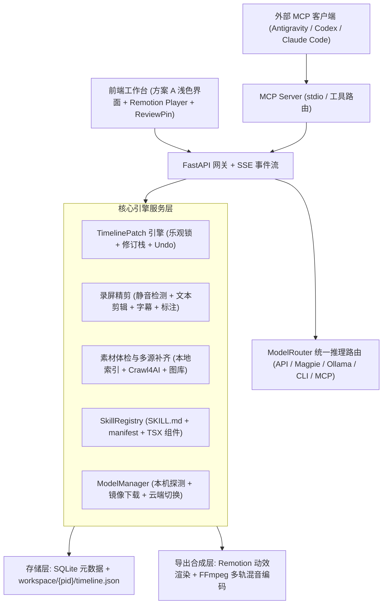
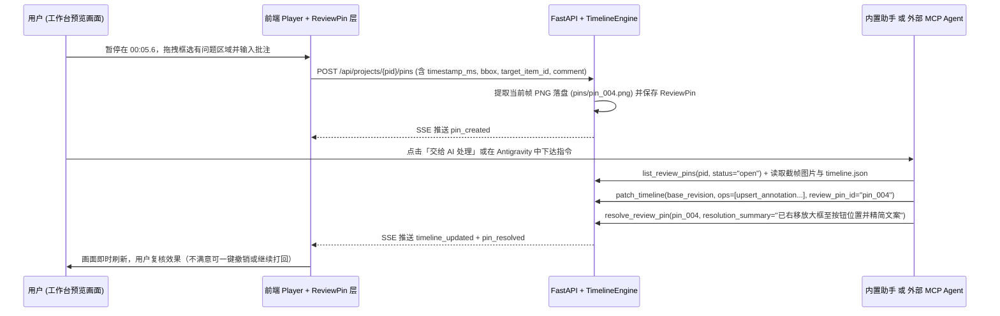
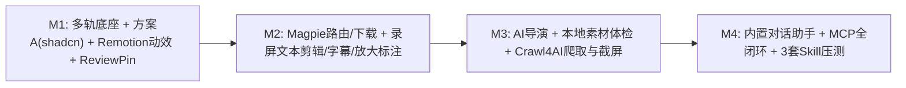

# ReelForge（映铸）v3.0 总体架构、UI 规范与里程碑总纲

> **文档权威性与维护铁律**：
> 本仓库仅维护两份顶层权威文档——[README.md](file:///Users/ryan/Documents/tools/ReelForge/README.md)（面向用户的安装、配置与使用手册）与本文件 **`project_plan.md`**（唯一权威的架构设计、数据契约、UI 规范、开源选型与里程碑进度追踪总纲）。
> **严禁在开发过程中随意新增零散的架构或设计 `.md` 文件**；每完成一个里程碑或接口变更，必须同步回写更新本文档中的状态看板与契约章节，确保全项目始终保持单文档权威、进度与设计高度一致。

---

## 0. 项目进度与里程碑看板（Milestone Tracker）

| 阶段 / 里程碑 | 执行顺序 | 核心定位 | 当前状态 | 关键基线 / 验收标志 |
|---|---|---|---|---|
| **v2.0 基线** | 已锁定 | 静态图文科普工作台（Playwright 静图 + `edge-tts` + FFmpeg + MCP） | ✅ **已完成并锁定** | Commit `a7f7f00` + `47faacf`（41 项 `pytest` 全绿） |
| **v3.0 设计定稿** | 前置门禁 | 统一多轨架构、方案 A UI 规范、开源选型与 M1–M4 路线收敛 | ✅ **已定稿（本文档）** | 本文件经审定并落库 |
| **Milestone 1（M1）** | 第 1 阶段 | 统一多轨底座 + Remotion 动态内核 + 方案 A 浅色工作台 + `ReviewPin` 原型闭环 | ⏳ **待启动** | 30fps 实时预览、5 轨混剪、框选截帧批注、1080P 导出、`ruff`/`pytest`/`build` 全绿 |
| **Milestone 2（M2）** | 第 2 阶段 | 本机环境/模型探测下载中心 + 系统录屏精剪（文本删词、极速字幕、重点标注） | ⏳ **待启动** | 一键探测与镜像下载 ASR、中文录屏去卡顿/口误、术语批量替换、重点放大导出 |
| **Milestone 3（M3）** | 第 3 阶段 | AI 导演对话 + 本地素材体检 + 可插拔 AI 联网爬取/截屏（`Crawl4AI`）与兜底 | ⏳ **待启动** | 杂乱本地素材目录增量索引对齐、`Crawl4AI` + 网页截屏补料、4 态降级兜底 |
| **Milestone 4（M4）** | 第 4 阶段 | 工作台内置对话改片 + 外部 MCP 全闭环 + 3 套完整 Skill 打磨与 16G 压测 | ⏳ **待启动** | 内置助手与外部 MCP 按 `ReviewPin` + `Skill` 精准 Patch、全矩阵真机验收 |

---

## 1. 定位升级、核心原则与硬件约束

### 1.1 从 v2.0 到 v3.0 的本质跃迁

v2.0 的 ReelForge 本质上是一套「**静态信息卡拼接机**」（Playwright 截静态 PNG → `edge-tts` 配音 → FFmpeg 拼接），仅适合纯图文科普，无法承接个人出镜口播、系统操作录屏剪辑、多素材宣传片混剪以及真正会动的 HTML 动效视频。

v3.0 将底层内核升级为 **「多轨时间轴 + Remotion 动态渲染 + FFmpeg 多轨合成 + 本地媒体理解」** 的一体化可编程工作台，正面解决 ChatCut 的三大痛点（粗剪粒度粗糙、中文识别与改字幕痛苦、纯对话不可控且工作台找不到功能）。

| 维度 | ReelForge v2.0（当前基线） | ReelForge v3.0（目标架构） |
|---|---|---|
| **内容形态** | 单一图文知识科普（9 套静态卡） | **四合一创作台**：系统录屏精剪 / 真人口播精剪 / AI 资讯与宣传片混剪 / 动态 HTML 科普动画 |
| **工程数据模型** | 单轨线性列表 `scenes[]`（每幕即一张静态卡） | 统一多轨工程 `TimelineDocument`（主轨 + 贴片 B-roll 轨 + 录屏标注轨 + 字幕轨 + 音频轨） |
| **渲染引擎** | `Jinja2 + Playwright` 静态截图拼接 | **浏览器内 `@remotion/player` 秒级实时预览** + 导出期 **Remotion + FFmpeg 分层合成** |
| **剪辑与精修** | 改单幕字段 + 重渲染整幕 | **文本删字剪辑**（去静音/卡顿/口误）+ **表格化极速改字幕** + **画布重点框选标注** + **多轨拖拽微调** |
| **素材能力** | 单张手动上传图片 + 简单网页摘要 | **本地目录增量体检**（抽帧 + ASR + VLM + 质量告警）+ **可插拔 AI 联网爬取/截屏**（`Crawl4AI` + 图库）+ **动态卡片/占位槽兜底** |
| **AI 协同方式** | 5-Agent 线性流水线（仅表单交互） | **对话导演 + 画布审片批注 `ReviewPin` + 双入口操作**（工作台内置助手 & 外部 MCP Agent 操作同一时间轴） |
| **模型与能力管理** | 手工配置 `.env` 环境变量 | **本机能力一键扫描（含 Magpie / Ollama / CLI）+ 轻量模型一键下载（镜像加速）** + 云端随时切换 |
| **模板扩展机制** | 模板写死在 `backend/app/templates/` 与 Pydantic Schema 中 | **编导 Skill 文件夹**（`SKILL.md` + `manifest.json` + React/Remotion 动效组件），内置 AI 与外部 MCP 共享 |

### 1.2 五条工程铁律

1. **单一真相源（Single Source of Truth）与非破坏性编辑**
   * `workspace/{project_id}/timeline.json` 是全系统唯一工程真相。无论是用户在 UI 拖时间轴、改字幕，还是内置 AI / 外部 MCP（Antigravity、Codex、Claude Code）改片，全部通过统一的 **原子 `TimelinePatch` 原语** 写入，并附带修订号快照（`timeline_revisions`），任何 AI 操作都支持一键撤销（Undo）与人工即时接管。
   * 原始录屏与素材文件只读引用，裁剪/去卡顿只记录 `source_in_ms` / `source_out_ms` 与删除标记，**永远不覆盖或破坏原始视频**。
2. **浏览器内毫秒级实时预览**
   * 预览态绝不反复调后端跑 headless 截图或重编码。前端通过 `@remotion/player` 在浏览器内实时合成渲染动态 HTML 动画、标注框、花字与字幕；导入大型录屏时后台异步生成轻量 720p Proxy 代理视频，保证拖动时间轴顺滑无卡顿。
3. **审片批注闭环（ReviewPin）**
   * 当用户不想亲手微调时间轴或标注位置时，直接在预览画面框选不满意的区域并写一句话批注；系统自动绑定时间戳、归一化坐标、当前轨道元素与截帧图片，打包提交给内置 AI 或外部 MCP Agent 定向修改。
4. **Local-First 且支持弹性切云**
   * 默认优先探测和复用本机能力（本地模型、Magpie 网关、本地渲染、本地素材扫描）；无模型时提供精选轻量模型一键下载（支持国内镜像加速）；同时也支持随时一键切换云端 ASR / 在线大模型 API / 本地 Ollama / 外部 Agent CLI 或 MCP。
5. **不造轮子与 Skill 可插拔扩展**
   * 前端直接组装成熟开源 UI 组件栈（`shadcn/ui`、`react-resizable-panels`、`cmdk`、`wavesurfer.js`、`@tanstack/react-virtual`）；每套视频风格/剪辑套路均作为独立 `skills/<skill_id>/` 目录插件化管理，新增同款风格无需改动核心引擎。

### 1.3 本机硬件基准与资源约束

基于工作站实测环境制定所有默认选型与内存预算：

| 环境项 | 本机实测值 | 对 v3.0 架构的硬约束 |
|---|---|---|
| **CPU / 架构** | Apple Silicon `arm64` | 优先采用原生支持 Apple Metal / MLX 或 CoreML 加速的本地推理库（如 `mlx-whisper`、`faster-whisper`），避免纯 x86 模拟器路径 |
| **统一内存** | `16 GB` | **严禁常驻多个大模型**；本地 ASR 模型优先推荐 `500 MB ~ 1.6 GB` 级量化版本；VLM 与本地文本模型（Ollama / `ReaderLM-v2`）按需加载并设空闲卸载；导出期严格采用「单幕/分段分层合成」，禁止同时开启多个高内存 Chromium + FFmpeg 并发进程 |
| **Python / Node** | `Python 3.11.15` / `Node v22.23.2` | 后端延续 FastAPI + Pydantic v2；前端与动效内核共享 React 18 + TypeScript + Vite 5 |
| **媒体工具链** | `FFmpeg 6.0`（含 `ffprobe`）、Playwright Chromium | 复用现成 FFmpeg 与 Chromium 缓存，音频响度、静音检测、Proxy 转码、最终多轨混音、以及 `Crawl4AI` 浏览器抓取全复用已有运行时 |
| **本机预装生态** | `ollama` / `claude` / `whisper` 未在默认 `$PATH`；`codex-cli 0.172.0` 位于 T3 工具目录 | 必须内置「本机环境扫描器 + 绝对路径探测 + 缺失模型一键下载」，不能假设用户终端已提前装好全部工具 |

---

## 2. 总体架构与目录规划（`main` 分支原地演进）

### 2.1 分层系统架构



### 2.2 仓库目录规划

核心工程决策：**将动态视觉组件收敛到统一的 `motion/` 包中**，前端 `@remotion/player` 实时预览与后端导出期 Remotion CLI **共用同一份 TSX 组件代码**，彻底杜绝 v2.0 时代后端 Jinja2 HTML 与前端编辑器逻辑割裂的问题。

```text
ReelForge/
├── project_plan.md                     # [唯一权威] 架构设计、UI 规范、接口契约与里程碑进度总纲
├── README.md                           # [唯一用户手册] 安装、启动、配置与使用指南
├── skills/                             # [新增] 编导 Skill 插件目录（AI 与渲染层共享）
│   ├── motion-editorial/               # 会动的 HTML 科普卡片（承接升级 v2.0 的 9 套模板）
│   ├── screen-tutorial/                # 系统操作录屏精剪与标注教程
│   └── ai-news-montage/                # AI 资讯 / 宣传片多素材混剪
├── motion/                             # [新增] Remotion 共享动效内核（前端预览 & 后端导出共用）
│   ├── package.json
│   └── src/
│       ├── Root.tsx                    # Remotion Composition 注册入口
│       ├── TimelinePlayer.tsx          # 消费 TimelineDocument 的通用多轨合成组件
│       ├── overlays/                   # 录屏标注（ZoomFocus / Spotlight / Callout）与字幕层
│       └── transitions/                # 通用转场与节奏动效
├── backend/
│   ├── pyproject.toml                  # [扩展] 补充 crawl4ai 及可选本地音频/ASR 依赖
│   └── app/
│       ├── main.py                     # [扩展] 静态/Range 视频流挂载、生命周期管理
│       ├── mcp_server.py               # [扩展] v3 完整 MCP 工具集（Timeline/Pin/Skill/Asset）
│       ├── core/
│       │   ├── config.py               # [扩展] 模型目录、镜像源、Crawl4AI、云端 ASR、Magpie/Ollama 等配置
│       │   ├── model_router.py         # [新增] 取代原 llm_client：统一文本/视觉/爬取抽取/ASR 多引擎路由
│       │   ├── model_manager.py        # [新增] 本机环境扫描、轻量模型目录与断点续传下载器
│       │   └── events.py               # [保留/扩展] 广播 timeline_updated、download_progress 等 SSE
│       ├── db/
│       │   ├── database.py             # [扩展] 增量建表（不破坏现有 projects 表结构）
│       │   └── repository.py           # [扩展] 时间轴修订、素材索引、ReviewPin、模型配置存取
│       ├── schemas/
│       │   ├── timeline.py             # [新增] TimelineDocument、5 条轨道、TimelinePatch 契约
│       │   ├── transcript.py           # [新增] 词级/句级 TranscriptDocument 与粗剪建议模型
│       │   ├── review_pin.py           # [新增] ReviewPin 审片批注模型
│       │   ├── asset.py                # [新增] MediaAsset、体检告警与候选检索模型
│       │   └── skill.py                # [新增] SkillManifest 与模板参数校验模型
│       ├── services/
│       │   ├── timeline_engine.py      # [新增] 原子 Patch 应用、base_revision 并发控制、Undo/Redo
│       │   ├── asr_service.py          # [新增] 本地 mlx-whisper / faster-whisper 与云端 ASR 适配
│       │   ├── screen_editor.py        # [新增] 静音/口误/重复句分析、热词替换、标注自动对齐
│       │   ├── asset_indexer.py        # [新增] 本地目录扫描、FFmpeg 代理转码、抽帧 + VLM 体检
│       │   ├── web_sourcing.py         # [新增] Crawl4AI 媒体与语义爬取 + 可选 Firecrawl/Jina/图库 + 截屏
│       │   ├── skill_registry.py       # [新增] 扫描 skills/ 目录，解析 SKILL.md 与 manifest.json
│       │   └── director_chat.py        # [新增] 对话式编导、本地素材对齐与缺口降级编排
│       ├── media/
│       │   ├── proxy.py                # [新增] 720p 低延迟预览代理视频生成与缩略图雪碧图
│       │   ├── remotion_runner.py      # [新增] 调用 Remotion CLI 渲染动态卡片或透明叠加层
│       │   ├── assembler.py            # [扩展] 多轨 FFmpeg 合成（切片/缩放滤镜/叠加/Ducking 混音）
│       │   ├── tts.py                  # [保留/扩展] edge-tts 与词级字幕对齐
│       │   └── assets.py               # [保留/扩展] 工程附件与共享素材库隔离
│       └── api/
│           ├── timelines.py            # [新增] 读取、Patch、Undo/Redo、导出接口
│           ├── transcripts.py          # [新增] 转写、文本删除同步、字幕修改、批量术语替换
│           ├── review_pins.py          # [新增] 画布框选批注 CRUD、自动截帧、提交 AI 修复
│           ├── models.py               # [新增] 本机检测、推荐模型清单、下载任务与进度、路由配置
│           ├── skills.py               # [新增] Skill 列表与详情查询
│           ├── media_library.py        # [新增] 素材库扫描、体检、联网爬取、Range 流式播放
│           ├── projects.py             # [扩展] 兼容 v2 项目并支持 v3 创作场景创建
│           └── external.py             # [扩展] 对齐 MCP 外部调用契约
├── frontend/                           # [重构] 方案 A 浅色创作台（shadcn/ui + CapCut 4区布局）
│   └── src/
│       ├── pages/
│       │   ├── HomePage.tsx            # 作品库大厅 + 4 场景快捷入口 + 新手 3 步引导
│       │   └── StudioPage.tsx          # 3 阶段工作台（规划与素材 / 剪辑与精修 / 导出与发布）
│       └── components/
│           ├── stage/                  # @remotion/player 包装器 + Screen Studio 包装 + ReviewPin 框选层
│           ├── timeline/               # 5 轨可视化时间轴 + wavesurfer.js 波形 + ReviewPin 标尺标记
│           ├── drawers/                # 左侧抽屉（文稿与字幕 / 素材库 / 模板Skill / 审片批注 / AI 助手）
│           ├── inspector/              # 右侧上下文属性检视器
│           └── modals/                 # 新建作品弹窗、Magpie 式环境与模型路由中心、Cmd+K 命令面板
└── tests/                              # [扩展] 按 M1–M4 分层补充单元测试与端到端 Playwright 验证
```

### 2.3 `main` 分支原地平滑迁移策略

1. **数据库增量兼容**：在 `backend/app/db/database.py` 启动初始化中保留既有 `projects`、`stage_runs`、`sources`、`scenes`、`event_logs` 表，通过 `CREATE TABLE IF NOT EXISTS` 与幂等列迁移新增 `timelines`、`timeline_revisions`、`transcripts`、`media_assets`、`review_pins`、`model_downloads`。
2. **v2.0 旧工程自动兼容**：打开历史 v2.0 项目时，若尚未生成 `timeline.json`，后端自动将其 `scenes` 映射为 `main_video`（`motion_card` 片段，归属 `motion-editorial` Skill）+ `subtitle` + `audio` 轨道的初始 `TimelineDocument`。
3. **测试脏数据清理**：M1 落地新首页时，清理 `workspace/` 中历史验收遗留的 `验收草稿 768`、`验收草稿 1440` 等脏数据，仅保留干净的 3 个多形态演示示例项目。

---

## 3. 核心数据契约（Schemas & Patch 原语）

### 3.1 `TimelineDocument`（5 条语义轨道设计）

`workspace/{project_id}/timeline.json` 采用毫秒精度（与音视频和 ASR 对齐）与确定性 FPS 渲染：

```json
{
  "schema_version": 3,
  "project_id": "proj_abc123",
  "revision": 14,
  "fps": 30,
  "format": "video_16_9",
  "resolution": { "width": 1920, "height": 1080 },
  "skill_id": "screen-tutorial",
  "theme": "clean_light",
  "tracks": {
    "main_video": [
      {
        "id": "clip_01",
        "kind": "motion_card",
        "skill_id": "motion-editorial",
        "component_id": "cover",
        "duration_ms": 3000,
        "transition_out": { "type": "fade", "duration_ms": 300 },
        "props": {
          "tag": "系统演示",
          "title": "3 分钟学会资产台账自动对账",
          "subtitle": "从录屏导入到重点标注完整流程"
        }
      },
      {
        "id": "clip_02",
        "kind": "video_clip",
        "asset_id": "asset_rec_01",
        "source_in_ms": 4200,
        "source_out_ms": 18600,
        "speed": 1.0,
        "volume": 1.0,
        "crop": { "mode": "cover", "focus_x": 0.5, "focus_y": 0.5 },
        "frame_style": { "rounded": true, "padding": 32, "wallpaper": "soft_slate" },
        "transcript_segment_ids": ["seg_01", "seg_02"]
      },
      {
        "id": "clip_03",
        "kind": "placeholder",
        "duration_ms": 4000,
        "prompt_hint": "缺素材：需要「对账成功导出报表」的界面截图或 4 秒录屏",
        "fallback_card": {
          "component_id": "checklist",
          "props": { "heading": "导出前核对 3 项", "items": [] }
        }
      }
    ],
    "overlay": [
      {
        "id": "ov_01",
        "kind": "broll_image",
        "asset_id": "asset_web_shot_09",
        "start_ms": 6500,
        "duration_ms": 2800,
        "rect": { "x": 0.62, "y": 0.14, "w": 0.32, "h": 0.36 },
        "border_radius": 16,
        "enter": "slide_up",
        "exit": "fade"
      }
    ],
    "annotation": [
      {
        "id": "ann_01",
        "kind": "zoom_focus",
        "start_ms": 5000,
        "duration_ms": 3200,
        "target_rect": { "x": 0.18, "y": 0.25, "w": 0.34, "h": 0.22 },
        "zoom_scale": 1.65,
        "spotlight": true,
        "callout_text": "点击这里发起自动校验",
        "ease": "cubic_out"
      }
    ],
    "subtitle": [
      {
        "id": "sub_01",
        "transcript_segment_id": "seg_01",
        "start_ms": 3100,
        "end_ms": 6800,
        "text": "打开对账中心后，先核对左侧筛选条件",
        "highlight_words": ["对账中心", "筛选条件"],
        "style_preset": "pill_dark"
      }
    ],
    "audio": [
      {
        "id": "aud_bgm_01",
        "kind": "bgm",
        "asset_id": "bgm_default_01",
        "start_ms": 0,
        "duration_ms": 21400,
        "volume": 0.35,
        "ducking_db": -12,
        "fade_in_ms": 600,
        "fade_out_ms": 1200
      }
    ]
  }
}
```

**主轨 4 种节点类型统一约束**：
* `video_clip`：本地实拍或录屏切片（支持非破坏性出入点、倍速、音量、智能裁切焦点、Screen Studio 风格窗口圆角包装）。
* `image_clip`：本地/网络图片片段（支持 Ken Burns 推拉动效或配合旁白配音）。
* `motion_card`：引用 `skills/` 下动态 TSX 模板的片段（替代 v2.0 静态卡片，且支持任意位置插入）。
* `placeholder`：缺料占位槽（当本地无素材且联网未搜到时，带着文案提示和可选兜底卡片进入时间轴，**保证工作流永不卡死**）。

### 3.2 原子化 `TimelinePatch` 与乐观锁机制

所有修改时间轴的操作（前端拖拽、文本删词、内置 AI 对话、外部 MCP 工具）必须提交统一结构的 `TimelinePatchRequest`：

```typescript
interface TimelinePatchRequest {
  base_revision: number;          // 乐观锁：不匹配当前版本则返回 409 Conflict + 最新文档
  actor: "user" | "internal_ai" | "mcp_agent";
  summary: string;                // 人类可读变更摘要（写入修订历史，如 "第2幕放大框右移并调长0.5秒"）
  review_pin_id?: string;         // 可选：由某条审片批注触发的修改
  ops: TimelineOp[];
}

type TimelineOp =
  | { op: "insert_clip"; index: number; clip: MainClip }
  | { op: "trim_clip"; clip_id: string; source_in_ms?: number; source_out_ms?: number; duration_ms?: number }
  | { op: "split_clip"; clip_id: string; split_at_ms: number }
  | { op: "delete_clip"; clip_id: string }
  | { op: "reorder_clips"; clip_ids: string[] }
  | { op: "replace_clip_asset"; clip_id: string; asset_id: string; source_in_ms?: number; source_out_ms?: number }
  | { op: "update_motion_props"; clip_id: string; props_patch: Record<string, unknown> }
  | { op: "upsert_overlay"; item: OverlayItem }
  | { op: "delete_overlay"; item_id: string }
  | { op: "upsert_annotation"; item: AnnotationItem }
  | { op: "delete_annotation"; item_id: string }
  | { op: "update_subtitle"; segment_id: string; text?: string; start_ms?: number; end_ms?: number; highlight_words?: string[] }
  | { op: "split_subtitle"; segment_id: string; split_char_index: number }
  | { op: "merge_subtitles"; segment_ids: [string, string] }
  | { op: "batch_replace_terms"; replacements: Array<{ find: string; replace: string }> }
  | { op: "upsert_audio"; item: AudioItem }
  | { op: "delete_audio"; item_id: string };
```

每次 Patch 成功：
1. Pydantic 严格校验所有引用 `asset_id` 存在、时间区间合法（`source_out_ms > source_in_ms`）、标注坐标在 `[0, 1]` 范围内。
2. 原子写入 `timeline.json`（临时文件 `.tmp` + `replace`），同时将旧版与 Patch 记入 `timeline_revisions` 表，支持随时回退到任意历史版本。
3. 通过 SSE 推送 `timeline_updated`（含新 `revision` 和变更操作列表），前端画布与时间轴零刷新同步。

### 3.3 `TranscriptDocument`（非破坏性文本剪辑模型）

用于录屏与口播场景，实现 **“像改 Word 文档一样删视频口误，且随时可恢复”**：

```json
{
  "asset_id": "asset_rec_01",
  "engine": "mlx-whisper-large-v3-turbo-q4",
  "language": "zh",
  "hotwords": ["ReelForge", "FastAPI", "Playwright"],
  "segments": [
    {
      "id": "seg_01",
      "text": "我们先打开，那个，对账中心",
      "clean_text": "我们先打开对账中心",
      "start_ms": 4200,
      "end_ms": 7400,
      "words": [
        { "id": "w1", "text": "我们", "start_ms": 4200, "end_ms": 4480, "tag": "normal", "deleted": false },
        { "id": "w2", "text": "先", "start_ms": 4480, "end_ms": 4650, "tag": "normal", "deleted": false },
        { "id": "w3", "text": "打开", "start_ms": 4650, "end_ms": 5020, "tag": "normal", "deleted": false },
        { "id": "w4", "text": "[停顿 0.8s]", "start_ms": 5020, "end_ms": 5820, "tag": "pause", "deleted": true },
        { "id": "w5", "text": "那个", "start_ms": 5820, "end_ms": 6180, "tag": "filler", "deleted": true },
        { "id": "w6", "text": "对账中心", "start_ms": 6300, "end_ms": 7400, "tag": "normal", "deleted": false }
      ]
    }
  ]
}
```

**核心映射规则**：
* 后端将所有 `deleted == false` 的连续词合并为「保留时间区间」（默认前后保留可配置的 `padding_ms = 80ms`，相邻间隔小于 `220ms` 不强行硬切，避免吞字和卡嘴）；
* 将计算得到的连续区间列表自动同步为 `main_video` 上对应的 `video_clip` 切片与 `subtitle` 字幕时间；
* 用户在文稿区随时点选被划线的灰色文字（如被误删的“那个”或整句重说），即可一键恢复原片段。

### 3.4 `ReviewPin`（画面框选审片批注与 AI 闭环）

解决用户核心诉求——**“我不想手调时，把屏幕上有问题的地方圈出来，直接让内置 AI 或外接的 Antigravity/Codex 帮我改”**：

```json
{
  "id": "pin_004",
  "project_id": "proj_abc123",
  "revision_id": 14,
  "timestamp_ms": 5600,
  "frame_path": "workspace/proj_abc123/pins/pin_004.png",
  "bbox": { "x": 0.16, "y": 0.22, "w": 0.36, "h": 0.24 },
  "target_track": "annotation",
  "target_item_id": "ann_01",
  "comment": "这个放大框偏左了，没有框住右侧的蓝色提交按钮，文字标注改简短一点",
  "status": "open",
  "created_at": "2026-11-26T15:10:00Z",
  "resolution_summary": null
}
```



### 3.5 `MediaAsset`（本地与联网素材库统一模型）

区分 **工程私有素材**（如项目录屏、上传的附件）与 **跨项目共享素材库**（用户配置的本地素材目录，如 `~/Movies/素材库`）：

```json
{
  "id": "asset_rec_01",
  "scope": "library",
  "source_type": "local_file",
  "original_path": "/Users/ryan/Movies/ScreenShots/对账演示.mov",
  "sha256": "9f86d081...",
  "media_type": "video",
  "width": 2560,
  "height": 1440,
  "duration_ms": 94200,
  "fps": 30,
  "has_audio": true,
  "proxy_path": "workspace/.library/proxies/asset_rec_01_720p.mp4",
  "keyframes": [
    { "timestamp_ms": 2000, "thumb_path": "...", "vlm_caption": "桌面软件登录页，浅色后台界面" },
    { "timestamp_ms": 14500, "thumb_path": "...", "vlm_caption": "财务对账表格，鼠标停留在右上角自动校验按钮" }
  ],
  "quality_flags": ["high_res_screen"],
  "source_url": null,
  "license_note": "本地自有素材"
}
```

---

## 4. 六大核心子系统技术方案

### 4.1 本机环境/模型探测与一键下载中心（ModelManager）

针对 **“先点检测按钮扫描本机已有模型/技术栈；没有就给出轻量好用推荐 + 一键下载；随时可切云端或 API Key”**，并结合 **Magpie** 优秀设计：

#### 1) 一键环境检测（`POST /api/system/probe`）
点击检测后，后端并发扫描并返回结构化体检报告：
* **基础工具**：`ffmpeg`、`ffprobe`、`node`、`chromium`、Apple Silicon Metal 可用性、可用磁盘与内存。
* **本地 ASR 引擎与模型缓存**：检测 Python 环境是否安装 `mlx-whisper` / `faster-whisper`，扫描 `~/.cache/huggingface`、`~/.cache/modelscope`、`workspace/.models/` 下已下载模型目录。
* **本地 TTS**：检测 `edge-tts`（在线高自然度语音）与 `espeak-ng` / `say`（离线兜底语音）。
* **本地 LLM / VLM / 统一网关**：探测 `http://127.0.0.1:11434/api/tags`（Ollama）、`1234`（LM Studio）以及本机 **Magpie 统一网关**（`127.0.0.1:3425`），列出已拉取或已托管的文本/多模态/网页解析模型（如 `qwen2.5:7b`、`qwen2.5vl:7b`、`reader-lm-v2`）。
* **本机 Agent CLI 与云端 Key**：探测 `codex`（含 T3 工具绝对路径探测）、`claude` CLI 可用性，以及 `.env`/设置页已配置的文本 LLM、VLM、ASR、图库、爬取 API Key 连通性状态（不回传明文 Key）。

#### 2) 精选轻量模型推荐清单与一键下载（适配 16 GB Apple Silicon）
前端展示每款推荐模型的**磁盘占用、内存峰值、中文准确度评级、速度评级**，点击「下载」后开启后台可取消下载任务，支持在设置里切换 **国内镜像源（默认优先 `HF-Mirror` / `ModelScope`）↔ HuggingFace 官方源**：

| 能力类别 | 推荐轻量模型 | 下载体积 | 运行内存 | 适用定位 |
|---|---|---|---|---|
| **本地中文 ASR（首选）** | `mlx-community/whisper-large-v3-turbo-q4` | ~580 MB | ~1.2 GB | Apple Silicon MLX 原生加速，中文词级时间戳准确且极快 |
| **本地中文 ASR（备选）** | `Systran/faster-whisper-medium`（int8） | ~780 MB | ~1.4 GB | 跨平台通用方案，词级时间戳稳定 |
| **本地热词/标点增强（可选）** | `FunAudioLLM/SenseVoiceSmall`（ONNX） | ~240 MB | ~0.6 GB | 中英混杂极快识别，适合口播快速转写 |
| **本地视觉识图 VLM（Ollama）** | `qwen2.5vl:3b` 或 `qwen2.5vl:7b-q4` | 2.4~4.8 GB | 3.5~6.0 GB | 离线给本地素材抽帧打标签、排查模糊/过暗问题 |
| **本地网页清洗模型（Ollama 可选）** | `reader-lm-v2`（1.5B 量化） | ~1.0 GB | ~1.8 GB | 专攻复杂 HTML→干净 Markdown 转换，省大模型 Token |

#### 3) 云端与本地路由无缝切换（`ModelRouter` + Magpie 单表映射风格）
借鉴 **Magpie** 的「Provider 集中托管 + 单表角色直选」设计，将 **「智能编导/改稿 LLM」「素材识图 VLM」「网页结构化抽取」「语音转写 ASR」「配音 TTS」** 五个角色各自独立选择：
* **ASR 插槽**：本机缓存模型 ↔ OpenAI Whisper 兼容 API ↔ 阿里云/火山引擎中文语音识别 API。
* **LLM / VLM / 网页抽取插槽**：DeepSeek / 通义千问 / OpenRouter 等 OpenAI 兼容 API Key ↔ 本机 Magpie 网关 / Ollama ↔ 本机 Agent CLI（Codex / Claude）↔ 外部 MCP（Antigravity 等）。

---

### 4.2 Remotion + FFmpeg 混合动态渲染与大文件代理管线

1. **导入即生成轻量预览 Proxy（解决网页播 2K/4K 录屏卡顿）**：
   * 用户导入超过 720p 或非标准关键帧间隔的 `.mov`/`.mp4` 录屏时，后台异步用 FFmpeg 转为 720p `yuv420p`、固定 `-g 15` 关键帧间隔的代理视频，通过 `/api/media/{asset_id}/stream` 提供 HTTP `206 Partial Content` 分片流传输。
   * `@remotion/player` 播放与时间轴拖动全程消费 720p Proxy，做到秒开、拖拽不卡；最终导出时切回原始 2K/4K 高清录屏文件进行无损裁切与放大，保证画质清晰。
2. **导出期分层合成策略（防止 16 GB 内存 OOM）**：
   * **场景类型 1（纯动态 HTML / 科普图文卡片）**：直接调用 `@remotion/cli` 渲染（输出 1080P MP4 或 3:4 PNG 序列），文字排版、SVG 图表动画与渐变背景原生抗锯齿。
   * **场景类型 2（录屏 / 口播 / 混剪重视频）**：采用「**FFmpeg 底座 + Remotion 透明动效叠加层**」分层合成：
     1. 先用 Remotion 按分段渲染包含动态标注框（`callout`）、标题开场（`motion_card`）、花字贴片与定制字幕的透明叠加视频层（PNG alpha 序列或 ProRes 4444）；
     2. 再由 FFmpeg 对原始高清主视频做精准切片（`trim` + `setpts`）、录屏聚焦平移缩放（`crop` + `scale` 平滑插值表达式），将 Remotion 透明动效层 `overlay` 叠加上去；
     3. 最后进行音频管线处理：人声响度标准化（`loudnorm=-16 LUFS`），BGM 自动通过 `sidechaincompress` 在人声出现时压低 12 dB 闪避，输出统一编码 `libx264 (yuv420p) + aac` 成片。

---

### 4.3 系统录屏与口播精剪引擎（正面解决 ChatCut 痛点）

1. **三段式精准粗剪（非盲删，先建议后一键确认）**
   * **物理层**：FFmpeg `silencedetect` 扫描全片大于阈值（如 `> 450ms`、电平 `< -38dB`）的静音空白段。
   * **词级层**：ASR 对齐每个字的时间戳，标出明显口癖（“嗯、啊、那个、就是说”）及超长停顿。
   * **语义层**：LLM 读入句级文稿，识别“口误后重说同一句话”（如第 3 句和第 4 句意思重复、第 3 句中途卡壳，自动建议保留第 4 句、删除第 3 句）。
   * **人工可控出口**：在文稿面板用醒目浅红/浅灰高亮标出建议删除段，提供「一键清理全部停顿」「一键清理口误重复」「保留 100ms 自然呼吸留白」滑块，任何标记点一下即可反悔保留。
2. **极速字幕精校（告别 ChatCut 难改痛点）**
   * 左栏「字幕表」按时间排序展示全部句子：点击任意一句视频秒跳至对应帧；支持表格内直接编辑文字、光标处按回车拆成两条短字幕、选中相邻两条按 `Cmd+M` 合并、超出单行字数自动标黄提醒。
   * 内置 **「项目专有名词词表」**：如技术项目常把 `FastAPI` 识别成“发斯特API”、`ReelForge` 识别成“瑞尔福”，在词表填一次即可全片一键批量替换，并记住为默认热词供下次 ASR 使用。
3. **录屏重点标注（无需复杂关键帧）**
   * 在预览画面直接开启「加标注」工具，框选屏幕按钮或报错区域，自动在当前时间戳创建 `zoom_focus`（聚光灯暗化周围 + 平滑放大 1.6× + 浮动说明气泡），在右侧面板或时间轴微调起止时间与文案即可，导出时由 FFmpeg 与 Remotion 同步呈现。

---

### 4.4 AI 导演对话、本地素材体检与可插拔 AI 联网爬取/抓图引擎

1. **对话定调 → 结构化分镜需求单（Shot List）**
   * 新建宣传片或 AI 资讯视频时，AI 导演先用 1~2 轮简短交互确认核心主题、受众、时长预期与风格（选择已有 Skill），随后产出每一幕的「画面需求描述（Shot Spec）」，标注每幕期望是“实拍/录屏”、“网页新闻/产品截图”还是“动态 HTML 信息卡”。
2. **本地素材库体检与语义对齐**
   * 用户可指定任意本地素材目录（如 `~/Movies/素材库`），`asset_indexer.py` 基于文件大小 + 修改时间 + SHA-256 做增量索引：视频用 `ffprobe` 测分辨率/帧率/音轨，结合场景切分（`scdet`）抽关键帧，若有音声则顺带跑轻量 ASR，再调用用户选定的 VLM（云端或本地 Ollama）生成中文画面摘要。
   * **自动体检告警**：不仅匹配“哪一段画面符合这一幕文案”，还会提前标出问题——例如 `横屏 16:9 强塞进 9:16 竖屏项目会裁切左右`、`片段只有 2.1s 低于本幕旁白 4.5s`、`画面严重过暗或无声音`。
3. **可插拔 AI 联网爬取与素材抽取层（`web_sourcing.py`，不绑死单一模型）**
   针对「像真人一样上网搜资料+扒配图/截图，且速度快、兼容 DeepSeek 及其他 OpenAI 协议模型」的需求，采用 **「浏览器爬取层 + 语义抽取层」解耦的插件架构**：
   * **默认本机零成本爬取引擎：`Crawl4AI`**
     * 开源 Python 库，**直接复用本机已安装的 Playwright Chromium**（无需 Docker 也无需付费 SaaS Key）；
     * 支持执行动态 JS、自动清除常见 Cookie/广告遮罩、输出干净结构化 Markdown；
     * 内置 **`result.media` 智能媒体提取与评分**（自动抽取页面高清图片/视频链接并过滤广告图标/小缩略图），同时支持对官网/GitHub/资讯首屏或关键段落生成高清截图；
     * **模型兼容抽取**：结合 `ModelRouter` 接入任意 OpenAI 兼容模型（DeepSeek / 通义千问 / OpenRouter / 本机 Magpie / Ollama），按分镜需求自动过滤废图、提炼配图说明与出处。
   * **可选本机专用网页清洗小模型：`ReaderLM-v2`（1.5B，Ollama）**
     * 专攻 HTML→干净 Markdown 转换的开源小模型，遇到复杂网页可先本地清洗再交给大模型或直接摘录，显著降低在线大模型 Token 消耗与等待耗时。
   * **可选云端加速 Provider**：设置中预留 `Firecrawl`、`Jina Reader`、`Tavily` 与免版权视频/图库 `Pexels` / `Pixabay` Key 插槽；有 Key 时一键切换云端加速，无 Key 时默认 `Crawl4AI + DuckDuckGo` 零门槛运行。
   * **快捷人工补料通道 & 合规红线**：支持素材栏 `Cmd+V` 粘贴剪贴板截图、拖入本地文件、或粘贴任意公开 URL 触发单页精准抓图；**严格禁止**制作绕过登录墙、验证码或强反爬的封闭平台爬虫，遇阻即优雅降级。
4. **缺料时的四态降级兜底（绝不卡死出片）**
   * 🟢 `aligned`：已匹配本地或联网选定素材；
   * 🟡 `needs_fix`：素材有比例或时长瑕疵（附一键修复按钮：居中裁切 / 轻微慢放）；
   * 🔵 `card_fallback`：没找到合适画面时，AI 自动切换为 `motion_card`（用动态 HTML 排版卡片完美表达该幕核心信息）；
   * ⬜ `placeholder`：暂空占位槽（标明还缺什么画面与建议时长，不影响先预览、先配音和继续编辑其他幕）。

---

### 4.5 编导 Skill 插件体系（`skills/` 目录规范）

将 ChatCut 里好用的“同款模板 / Skill”升级为**既规范 AI 编导结构、又自带动画组件的标准化文件夹**：

```text
skills/
└── screen-tutorial/
    ├── SKILL.md                # AI 导演与剪辑规则（结构节奏、字数上限、何时放放大标注/信息卡）
    ├── manifest.json           # Skill 元信息、支持画幅、表单 Schema、预设参数
    └── components/             # 可选专属 React/Remotion 动效组件
        ├── StepIntro.tsx
        └── FeatureCallout.tsx
```

* **`SKILL.md`**：沿用人类与 Agent 都易读的 Markdown 规范（YAML frontmatter 声明 `name`, `description`, `supported_formats`, `default_pace` + 正文结构规则）。无论是工作台内置导演还是外部连接的 Antigravity/Codex，开始编导前只需调用 `read_skill(skill_id)` 即可按照同款节奏出片。
* **`manifest.json`**：声明可调样式变量（主色、字体、字幕预设、转场风格）与组件输入 Props 的 JSON Schema，前端检视器自动据此渲染编辑表单。
* **首发 3 套内置 Skill 规格**：
  1. `motion-editorial`：承接并动画化 v2.0 全部 9 套排版模板（封面、图片卡、金句、编号卡、数据图、对比卡、时间线、关键数字、行动清单），实现“会动的 HTML 科普视频”。
  2. `screen-tutorial`：面向软件/系统操作教程，内置「三段式节奏（痛点开场卡 → 录屏+标注步骤 → 总结清单卡）」与自动放大标注规范。
  3. `ai-news-montage`：面向个人账号 AI 资讯/科普混剪，内置「3 秒钩子快切 + 网页截图画中画 + 核心数据动效卡 + 高亮节奏字幕」规则。

---

### 4.6 双入口 AI 协同、统一推理路由与 MCP 协议

工作台内置 AI 助手与外部 MCP Agent（Antigravity / Codex / Claude Code）共享同一套后端服务与 `TimelinePatch` 协议，操作同一份工程：

| 工具 / 接口域 | 核心 REST API（工作台使用） | 对应 MCP Tool（外部 Agent 使用） |
|---|---|---|
| **环境与模型** | `POST /api/system/probe`, `POST /api/models/download`, `PATCH /api/system/routing` | `get_system_capabilities` |
| **Skill 体系** | `GET /api/skills`, `GET /api/skills/{skill_id}` | `list_skills`, `read_skill` |
| **工程与时间轴** | `GET /api/projects/{pid}/timeline`, `PATCH /api/projects/{pid}/timeline`, `POST .../undo` | `get_timeline`, `patch_timeline`, `undo_timeline` |
| **文稿与字幕** | `POST /api/projects/{pid}/transcribe`, `PATCH /api/projects/{pid}/transcript` | `get_transcript`, `edit_transcript_cuts`, `update_subtitles` |
| **素材体检与爬取** | `POST /api/library/scan`, `POST /api/projects/{pid}/sourcing`, `POST .../web-capture` | `search_local_assets`, `crawl_web_media`, `capture_webpage_shot`, `attach_asset` |
| **审片批注闭环** | `GET/POST /api/projects/{pid}/pins`, `POST /api/projects/{pid}/pins/{pin_id}/ai-fix` | `list_review_pins`, `resolve_review_pin` |
| **导出与交付** | `POST /api/projects/{pid}/render`, `GET /api/projects/{pid}/publish-kit` | `render_project`, `get_project_status` |

---

## 5. UI 设计规范、成熟产品对标与开源选型

### 5.1 逐模块成熟产品对标矩阵（学什么 + 避什么坑）

| ReelForge 模块 | 对标产品 | 重点借鉴的交互与设计精华 | 必须回避的坑 / ReelForge 专属增强 |
|---|---|---|---|
| **模型检测、下载与路由中心** | **Magpie**（开源 macOS 网关） | **Provider 池集中托管 + 单表角色映射（Role → Model 下拉直选）**；自动探测本机端口（Magpie `127.0.0.1:3425`、Ollama `11434`、LM Studio `1234`）与云端同构切换。 | Magpie 缺媒体模型下载体验。<br>**增强**：加入「一键本机探测 + 推荐轻量中文 ASR/VLM/网页清洗模型 + 国内镜像进度下载」。 |
| **主剪辑工作台骨架与时间轴** | **CapCut Web / 剪映** | **经典 4 区黄金非编布局**（左 Icon Rail + 可折叠资源面板、中上舞台、右上检视器、下半屏通栏多轨时间轴）；轨道顶部快捷操作条（撤销/分割/删除/吸附/缩放）；媒体类型分色与单轨锁定/静音/显隐。 | 传统剪映偏黑密、VIP 入口多、缺文稿联动。<br>**增强**：方案 A 浅色分层 + 左抽屉原生承载「文稿删词 / 字幕表 / 批注」。 |
| **文本删字剪辑与口误清理** | **Descript** | 左栏文稿与主轨双向实时绑定、点字跳帧；标灰静音停顿 `[0.8s]` 与口癖重复句；**非破坏性删改**并支持点击复原。 | 纯英文对中文专有名词纠错弱。<br>**增强**：呼吸留白缓冲滑块 + 项目专有名词一键批量替换。 |
| **录屏包装与局部放大标注** | **Screen Studio** | 录屏自动圆角窗口 + 渐变壁纸衬底 + 柔阴影；平滑贝塞尔 `zoom_focus` 推拉与聚光灯高亮，无需手 K 复杂关键帧。 | 支持导入任意已有 `.mov/.mp4` 录屏后自由框选添加 `zoom_focus` / `spotlight` / `callout_box`。 |
| **画布框选审片批注** | **Frame.io** | 暂停帧直接框选留批注；时间轴同步展示 Pin 标记点，点击秒跳对应帧。 | 打通「Pin → 内置 AI / 外部 MCP」闭环，一键看图+坐标自动修改。 |
| **极速字幕精校** | **飞书妙记 / 剪映字幕列表** | 紧凑双列表格（时间码 + 文本框 + 字数预警），点句跳帧、回车拆句、快捷键合并。 | 绝不把改字幕藏进弹窗，保证录屏场景下常驻左抽屉直接开改。 |
| **对话编导与 Skill 模板** | **ChatCut** | 对话起手出片思路、一键套用同款 Skill、外部 MCP 协同。 | **严格避坑**：① 绝不隐藏常用剪辑按钮；② 绝不做黑盒不可撤销改动；③ 增加 `Cmd+K` 全局命令面板防迷路。 |

### 5.2 拒绝重复造轮子：成熟开源前端组件栈

| 能力域 | 选定开源库 / 方案 | 选型理由与集成方式 |
|---|---|---|
| **基础组件与无障碍交互** | **`shadcn/ui` + `@radix-ui/react-*` + Tailwind CSS** | 源码归己且天然适配方案 A Token；全面替代原生 `<select>`、`<input type="file">`、`alert()`、`confirm()`。 |
| **可拖拽工作台分栏** | **`react-resizable-panels`** | 支撑 CapCut 式 4 区自由拖拉、折叠与 `localStorage` 尺寸持久化。 |
| **全局直达命令面板** | **`cmdk`** | 按 `Cmd+K` 搜所有动作/Skill/面板跳转，彻底解决功能找不到的问题。 |
| **动态渲染与组件注册** | **`@remotion/player` + `remotion` + `remocn` 范式** | `motion/` 与 `skills/` 采用 `remocn`（shadcn 风格可复制 Remotion 组件）结构，预览与导出同源。 |
| **5 轨可视化时间轴** | **Remotion Timeline 架构 + `@dnd-kit/core`** | 复用成熟拖拽/指针原语搭配轻量毫秒↔像素标尺层，完美适配 5 条语义轨道 + `ReviewPin` + 非破坏性 `Transcript` 联动，避免重型通用库难改死黑样式的问题。 |
| **真实音频波形** | **`wavesurfer.js`** | 音频轨与试听面板渲染真实波形，肉眼直观看见静音空白段。 |
| **万行级流畅列表** | **`@tanstack/react-virtual`** | 长录屏数百上千条字幕表格行内编辑稳定 60fps。 |
| **状态与快捷键** | **`zustand` + `react-hotkeys-hook` + `sonner` + `lucide-react`** | 分片状态订阅避免拖播放头卡顿；标准化快捷键自动屏蔽输入态冲突；轻量 Toast 反馈。 |

### 5.3 方案 A（浅色清爽创作台）设计 Token、轨道语义色与红线

* **基础面层 Token**：应用画布底 `#f8fafc`｜面板浮层 `#ffffff`｜视频舞台中性灰 `#eef2f6`｜控件底槽 `#f1f5f9`｜细描边 `#e2e8f0`｜主文字 `#0f172a`｜次文字 `#64748b`｜唯一主强调色 `#2563eb`（hover `#1d4ed8` / 选中浅底 `#eff6ff`）。
* **5 轨低饱和语义色（3px 左色条 + 柔底）**：
  * 主视频轨 `main_video`：`#3b82f6` / `#eff6ff`（缺料占位槽用虚线边框 `#94a3b8`）
  * 贴片轨 `overlay`：`#06b6d4` / `#ecfeff`
  * 录屏标注轨 `annotation`：`#8b5cf6` / `#f5f3ff`
  * 字幕轨 `subtitle`：`#6366f1` / `#eef2ff`
  * 音频轨 `audio`：`#10b981` / `#ecfdf5`
  * 审片批注 `ReviewPin`：`#f59e0b` / `#fffbeb`（仅用于时间轴标尺小号标记点与角标）
* **排坑红线**：
  1. 任意视口同一时刻最多只保留 **1 个实心蓝底主按钮**；
  2. 所有时间码与数值强制 `tabular-nums` 等宽显示；
  3. 品牌名（`ReelForge · 映铸`）与当前项目名（`← 作品库 / 项目名`）严格分层隔离；
  4. 切到「导出与发布」页时必须隐藏剪辑时间轴与单幕表单；
  5. 严禁把 API Key / MCP / 模型下载塞进「新建作品」首屏必选项；
  6. 严禁 AI 修改静默覆盖用户手调结果（必须附变更摘要与一键撤销）。

### 5.4 核心页面布局蓝图与非编快捷键

#### 作品大厅首页（Home）
```text
+-----------------------------------------------------------------------------+
| [Icon] ReelForge · 映铸     [本地素材库] [● 环境与模型: 已就绪] [设置] [+新建作品] |
+-----------------------------------------------------------------------------+
|  3 步创作： ① 选择场景与选题 → ② 对齐素材 / 精修文稿与时间轴 → ③ 一键导出成片        |
|  从场景开始： [系统录屏精剪]  [真人口播精剪]  [AI资讯/宣传片混剪]  [HTML动态科普]      |
|  作品库 (03)                       [搜索作品...]   [全部] [16:9] [9:16] [3:4] |
|  [ 封面图 · 已完成 · 对账系统操作教程 ]  [ 封面图 · 剪辑中 · 上海租房 ]  [ 混剪草稿 ]   |
+-----------------------------------------------------------------------------+
```

#### CapCut 式 4 区剪辑工作台（阶段 ② 剪辑与精修）
```text
+------------------------------------------------------------------------------------+
| ← 作品库 / 对账系统操作教程 [16:9] | ①规划与素材 → ②剪辑与精修 → ③导出与发布 | [⌘K] [···] [导出成片] |
+----+-------------------+---------------------------------------+-------------------+
| 文 | 文稿与字幕 / 素材 / |  ● 预览舞台       [框选批注] [加放大框] | 检视器 (选中: 放大框) |
| 稿 | 批注 / AI助手       |  +---------------------------------+  | 位置与大小: X/Y/W/H |
| 素 |-------------------|  |  Screen Studio 风格窗口衬底       |  | 放大倍率: [1.65x]  |
| 材 | [一键去停顿] [术语替换]|  |  +-----------------------------+  |  | 聚光灯暗化: [开关]  |
| 模 | 00:04.2 先打开对账  |  |  |  录屏实时画面 + [橙色Pin框]  |  |  | 说明文字: [点击校验]|
| 板 | 00:07.5 [删:那个]   |  |  +-----------------------------+  |  | 进出场缓动: [Cubic] |
| 标 | 00:08.1 点击自动校验  |  |        [字幕实时叠加预览]        |  |                   |
| 注 |                   |  +---------------------------------+  |                   |
| 批 |                   |  ▶  00:05.6 / 01:12.0   [1.0x] [16:9] |                   |
+----+-------------------+---------------------------------------+-------------------+
| [撤销][重做][分割][删除]  [吸附:开]   [- ━━●━━ + 缩放]   [Pin #1][Pin #2]           |
| 标尺  00:00       00:10       00:20       00:30       00:40                        |
| 标注  |          [紫: 放大框·自动校验]                                                |
| 贴片  |                [青: 官网截图画中画]                                           |
| 主轨  | [蓝:封面][       蓝: 录屏_01 切片       ][ 灰虚线: 缺图占位槽 ]                  |
| 字幕  |          [靛: 先打开对账中心][靛: 点击自动校验]                                |
| 音频  | [绿: ▁▃▆█▅▂▁▅▇ BGM (人声自动闪避 -12dB) ▁▃▅▆▂▁ ]                           |
+------------------------------------------------------------------------------------+
```

#### Magpie 式「环境、模型与路由」设置中心 & 快捷键总表
* **Tab 1 任务路由单表**：一张表映射 `LLM 编导 / VLM 识图 / 网页抽取 / ASR 语音转写 / TTS 配音` 五个角色的引擎来源、模型选择与 `[测试]` 按钮；检测到本机 Magpie 网关（`127.0.0.1:3425`）时支持一键导入。
* **Tab 2 本机能力探测与一键下载**：`[一键扫描本机]` 报告工具与模型缓存状态；推荐模型卡片标明体积与 16G 内存占用，支持 `HF-Mirror / ModelScope / HuggingFace` 数据源切换与进度下载。
* **Tab 3 云端 Key 与外部 MCP**：集中管理 API Key（含 Pexels/Firecrawl/Jina 可选）与 Codex / Claude Code / Antigravity MCP 一键复制。
* **核心快捷键**：`Space` 播放/暂停｜`Cmd+K` 全局命令面板｜`S` 分割片段｜`Delete` 删除选中｜`Cmd+Z` / `Cmd+Shift+Z` 撤销/重做｜`P` 画布框选批注｜`Z` 快速加放大标注｜`Enter` / `Cmd+M` 拆句/合并字幕。

---

## 6. M1 → M2 → M3 → M4 顺序执行路线图



### Milestone 1（M1）：统一多轨底座 + Remotion 动态内核 + 方案 A 新工作台 + ReviewPin 原型闭环
* **核心目标**：替换 v2.0 静图骨架为 `TimelineDocument` + Remotion/FFmpeg 分层合成，落地基于 `shadcn/ui` + `react-resizable-panels` + `cmdk` 的方案 A 新工作台，清理历史测试脏数据。
* **主要交付物**：
  * `TimelineDocument` 与原子 `TimelinePatch` 引擎（`base_revision` 乐观锁、Undo/Redo 修订栈、v2.0 旧工程自动转换）。
  * `motion/` 包与首批 `motion-editorial` Skill（9 套经典模板升级为带动画的 Remotion TSX 组件）。
  * Remotion CLI + FFmpeg 分层导出 + 720p Proxy 代理转码与 HTTP `206 Range` 流式播放。
  * 方案 A 前端（首页 + 3 阶段工作台 + `@remotion/player` + 5 轨时间轴 + `wavesurfer.js` + `ReviewPin` 画布框选落盘）。
* **验收标准**：`ruff`、`pytest`、`npm run build` 全绿；浏览器舞台 30fps 实时预览动态 HTML 科普项目；导入本地 MP4 与动态卡片混剪导出 `1080P final.mp4`；画面框选创建的 `ReviewPin` 含截帧与坐标并可通过 API/MCP 读取。

### Milestone 2（M2）：本机模型探测下载中心 + 系统录屏精剪全套工作流
* **核心目标**：打穿刚需场景「系统操作录屏剪辑」，集成 Magpie 式路由面板与可取消的镜像下载器。
* **主要交付物**：
  * `ModelManager` 与 Magpie 式「环境、模型与路由」设置中心（探测 FFmpeg/Ollama/LM Studio/Magpie `3425`/Codex CLI，一键下载轻量 ASR/VLM/`ReaderLM-v2`，支持云端 ASR API 切换）。
  * `asr_service.py` & `screen_editor.py`（`mlx-whisper` / `faster-whisper` 词级时间戳、静音+口癖+重复句建议、非破坏性文本删字剪辑、呼吸留白滑块）。
  * `@tanstack/react-virtual` 极速字幕表格面板（点句跳帧、拆句、合句、专有名词批量替换）。
  * Screen Studio 风格录屏包装与 `zoom_focus` / `spotlight` / `callout_box` 画布框选标注 + `screen-tutorial` Skill。
* **验收标准**：点击「检测本机」正确识别缺失模型并完成镜像下载；导入含刻意停顿、口误重说和专业英文词汇的中文录屏，端到端完成清理、批量术语替换、2 处放大高亮标注与 BGM 自动闪避导出，目视与听觉验收流畅无卡顿。

### Milestone 3（M3）：AI 导演对话 + 本地素材体检 + `Crawl4AI` 联网爬取与截屏补料
* **核心目标**：打通「聊想法 → 出分镜需求单 → 本地目录体检对齐 → `Crawl4AI` 联网搜图/网页截屏补缺 → 动态卡/占位槽兜底」。
* **主要交付物**：
  * `ModelRouter` 全量兼容（DeepSeek / OpenAI 兼容 API、Magpie、Ollama、本机 CLI、外部 MCP 及 `MOCK_LLM=true`）。
  * `asset_indexer.py`（增量扫描、场景切分、VLM 抽帧摘要、比例/时长/画质告警）。
  * `web_sourcing.py`（`Crawl4AI` + OpenAI 兼容抽取 + `ReaderLM-v2` 可选清洗 + Playwright 智能截屏 + 可选 `Firecrawl`/`Jina`/`Pexels`/`Pixabay` + `Cmd+V` 粘贴入库）。
  * `director_chat.py`（Shot List 对话生成与 4 态槽位 🟢/🟡/🔵/⬜ 渲染）+ `ai-news-montage` Skill。
* **验收标准**：给定杂乱本地素材目录 + AI 资讯/宣传片选题，自动匹配本地片段并提示比例瑕疵、通过 `Crawl4AI` 从公开技术页面提取高清配图/截屏补齐缺口，剩余缺口自动转动态信息卡或占位槽后顺利导出成片。

### Milestone 4（M4）：工作台内置对话改片 + 外部 MCP 全闭环 + 3 套 Skill 压测验收
* **核心目标**：实现基于 `ReviewPin` 和 `Skill` 规范的对话精准微调与外部 MCP 全链路协同。
* **主要交付物**：
  * 扩展版 `mcp_server.py` 与内置工作台 AI 对话代理（读时间轴、读 `ReviewPin` 截帧、按 `Skill` 调用 `patch_timeline` 局部改片并标记解决）。
  * 3 套完整 Skill 跨三画幅（`16:9` / `9:16` / `3:4`）全矩阵真机测试与 16 GB 内存长视频导出压测。
* **验收标准**：分别通过工作台内置对话与外部 Antigravity/Codex MCP 完成一次针对 `ReviewPin` 框选区域的精准修改（调整标注框、换配图、调 BGM），前端实时同步且可一键撤销。

---

## 7. 工程风险清单与防坑指南

| 风险点 | 触发场景 | 预防与兜底方案 |
|---|---|---|
| **16 GB 内存 OOM** | Remotion 多并发渲染 + 本地 Whisper / Ollama / `ReaderLM-v2` 同时驻留 | 推理与导出分时调度；大视频生成 720p 代理流；导出重视频优先用 FFmpeg 分段合成，限制并发 Worker（≤ 2），模型管理提供释放空闲模型按钮 |
| **网页预览大录屏卡顿** | 直接播放几百 MB 高码率 `.mov`（关键帧间隔过大） | 导入异步转码 720p 低 GOP（`-g 15`）Proxy 代理文件并走 `206 Range` 流式请求；导出阶段切换回原始高清文件 |
| **国内网络下载模型失败** | 从 HuggingFace 直连拉取百兆/GB 级模型中断 | 默认配置国内镜像源（`HF-Mirror` / `ModelScope`），支持断点续传、取消按钮与一键切回官方源 |
| **AI 误删 / 改乱时间轴** | 对话或 MCP Agent 一次改坏多处片段 | 强制走带摘要的原子 `TimelinePatch`，每次落盘自动保存 `timeline_revisions` 快照，随时一键撤销 |
| **前端手调与 MCP 并发冲突** | 用户拖拽同时外部 Agent 写入同一工程 | 强制 `base_revision` 乐观锁，冲突返回 `409` 及最新时间轴状态，由请求方基于新版重算 Patch |
| **联网爬取遇反爬 / 登录墙** | 试图抓取需要登录或带验证码的封闭网站 | 严禁脆弱爬虫；默认 `Crawl4AI` 聚焦公开网页/技术博客/图库，遇阻优雅降级为 `Cmd+V` 粘贴截图、动态卡片或占位槽 |
